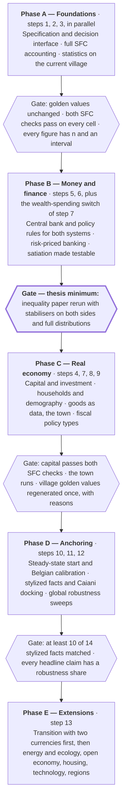

# From BreadEconomySim to a full ABM engine — implementation roadmap

*18 October 2026; brought up to date on 25 and 26 October 2026 (see the update below). A working document: every design choice below is open to challenge. Source of truth for the plan until superseded; decisions taken against it are recorded in `HANDOFF_2026-09-18.md`.*

## Update of 25 October 2026 — where things stand before the refactor

**Status.** The talk of 25 October is given. The bread model stands at version `2026-10-25.2` (72,728 tests). **The refactor is the next step**, starting with Phase A; this version is the reference Phase A must reproduce. The week's decisions and traces are in `HANDOFF_2026-09-18.md`; the talk's numbers and their caveats in `docs/talk/handoff_talk_2026-10-22.md` (§4k–§4l).

**What changed in the bread model since 18 October** — all of it must survive the refactor (four new rows in the checklist below):

- *Comparisons on identical rules.* `run_all(fiscal = :taxes | :parking)` gives both villages the same fiscal package at every rung (income taxes, or a 1.5 % tax on balances above a cushion of 30), and a test asserts that the two villages' settings differ only in money fields. The surplus rule (`surplus_rule = :debt_levy_taxcut`): the benefit and public wages are paid, the land tax is paid out to everyone, debt is serviced by its terms, the surplus builds a three-month reserve, and once that is full every other tax comes down. The land tax never falls below its base rate (`levy_scale_floor`); a lever raises it so that income plus the land dividend is a meal (SuMSy). Under the parking package the debt village pays a meal-sized basic income from the tax on idle money and borrowing, with no separate benefit.
- *Base rules added to the ladder* (each a switch, off in the model's defaults so the golden values hold): debt collection stops at a meal (`collection_floor_in_breads = 2`); the banks' loan rate covers their staff at the going wage, and staff scale with loans (one unit per 12 loans); a greedy firm's ask is set from the price last paid; bakeries bake to their target, not their hands; prices fall only when sales are 10 % below expectation and rise only when demand is 10 % above it (`price_on_expected_sales`, `price_rise_band`); a firm that turned customers away plans more; the cost floor passes on at most the spoilage of the planned buffer; an heir receives all the dead villager's assets, and nothing is paid into a dead account (`inherit_all_assets`); heirs' and firms' debt inheritance exist as experimental switches, off.
- *The realistic set* (`REALISTIC_LABOUR`): contracts for four fifths of the hands, indexed to bread, with notice; own-market planning (three-month average of sales plus customers turned away, net of stock) with an adaptive buffer; the cost floor carrying interest and the founding loan's instalments (`floor_debt_service = :long`) and spreading spoilage over what sells; farms buying land only on a term the rent and reserve can carry, and the land price meeting the best offer; deleveraging by land sales; a minimum of two firms of each kind; sale of a failing firm before closure.
- *Speed.* Settled loans pruned with unique ids and an indexed loan lookup; the wealth sums of the data row, the invoice settlement, the land reservation and the share valuations computed once per month instead of once per candidate. Results identical (old code against new, column by column); a 24-month run about six times faster than on 24 October morning.
- *GDP and public debt as a share of GDP (26 Oct, version `2026-10-26.0`).* Each month the data row carries GDP by spending — final sales of bread, tickets and premium loaves (`gdp_consumption`); public wages, government output valued at cost (`gdp_government`); the banks' margin, the month's change in retained interest plus account fees (`gdp_banks`); the change in the bakeries' unsold stock at the price paid (`gdp_inventory`) — summed in `gdp_nominal`, with `gdp_annual` (trailing twelve months), GDP in loaves per survivor and per starting villager, and `public_debt_pct_gdp` (public debt over the trailing twelve months' GDP). Grain is an input and land is not produced, so neither counts. The run summaries' existing debt ratio now uses this GDP (before, bread and tickets only — it left out the government and overstated the ratio); `gdp_per_head_loaves` joins them. A test checks that the pieces add up. Step 3 must carry it, with the improvements listed there.
- *Infrastructure.* Combined outputs carry the version in their names; `scripts/regression_check.jl` (one cell against an earlier run, month by month), `death_trace.jl`, `profile_run.jl`, `prune_check.jl`, `talk_run.jl`; `run_all` refuses a step name that matches nothing; a test fails on any code placed after a comment on the same line.

**Bugs found this week, and what they teach the refactor's test harness.** A mid-line comment swallowed the rest of a definition three times (18, 23 and 24 Oct: eighteen ladder rules, V8's starting prices) → the comment test, kept. A price rule raised prices on any sell-out but cut them only on a 10 % shortfall → a ratchet (debt village bread 6 → 39) → every price rule needs a symmetry test. A floor that divided by the spoiled share doubled a refounded farm's price and starved a village with full pockets → floors need a test that unsold stock cannot raise its own price. Wage arrears earned before death were booked into dead accounts at clearing, outside `transfer!` → Step 2 needs a check that no payment reaches a dead agent and that every estate account is empty after settlement.

**Findings that bear on the steps** (each is traced in the handoffs):
- *Step 5.* With the cost fix the model's banks still keep 83–97 % of their revenue (one employee; real banks about 30 %): bank costs must scale with customers and loans and be calibrated (`docs/future_work/banks_on_real_world_economics_2026-10-23.md`).
- *Step 6.* The debt village has no nominal anchor. At step 2 under realistic rules it inflates (bread up 6.8 % a year): a government borrowing to pay a benefit set at the price of two loaves creates the money that drives the price. In the productive village (V8) it deflates without end once its founding loans are repaid and nothing is fixed in money; an income fixed in money stops it (345k of public debt in ten years). A policy rate that responds to inflation is the obvious missing stabiliser; it must be tested, not assumed.
- *Step 7.* Labour supply is need-based: villagers offer the hours that cover a meal, a cushion top-up and the theatre tickets, less other income. Both villages work about seven hours in ten; the SuMSy villager asks for fewer and gets them, the debt villager asks for more and 6–17 % of capacity goes unfound.
- *Step 8.* Ownerless firms have no working outlet for cash above their reserve under contracts (realistic bare debt village: bakeries at 2.5–11× their reserve, holding 48–83 % of the money); the contraction trap (two firms of each kind) is still open.
- *Step 9.* The land-tax floor makes the SuMSy village's land tax pay out two to three meals a head in the productive village, which then inflates about 8 % a year; whether the part above the meal target should be paid out or go to the reserve is a design decision (open questions).

## Purpose and scope

Thirteen implementation steps turn BreadEconomySim.jl into MacroSim.jl. The result is an engine that covers what macro agent-based models (MABMs) now treat as standard, and keeps what the bread village adds.

"Standard" is taken from three sources. Dawid and Delli Gatti (2018) describe the common core of eight MABMs. Caiani et al. (2016) set the bar for stock-flow consistency (SFC), calibration and validation. Ponta et al. (2018) show current practice in policy experiments and statistical testing.

"What the bread village adds" is listed in its own section near the end. That section is a checklist: every item on it must still work after the refactor.

**How to read a step.** Each step has the same five parts:

- **Why** — the gap it closes, and which claim it makes defensible.
- **What the literature does** — the reference design, so you can compare.
- **What to build** — numbered sub-steps, small enough for one session each.
- **Done when** — tests that must pass before the step counts as finished.
- **Depends on** — steps that must come first.

**What this document does not cover.** It does not repeat SuMSy's design or the report's findings. Legislation stays in the Dutch book. Every design choice below can be overruled; the open questions at the end list the ones that need a decision first.

**A word on terms.** A *transaction model* is one concrete economy built on the engine, such as the bread village. A *module* is a reusable part of the engine, such as "banking" or "capital goods". A *switch* is a setting that turns a behaviour on or off without changing code.

## Design principles

Twelve principles govern every step below; six come from the bread village, six from the literature. When a step seems to conflict with one, the principle wins and the step is redesigned.

**Kept from the bread village**

1. **Behaviour is identical across monetary systems.** The money system is a module you swap. Agents never ask which system they live in, unless the behaviour itself is the experiment (the greed and hoarding cells).
2. **Realistic behaviour is on by default.** A new behaviour arrives as a switch. A rule found to be a defect is removed, never kept as a comparison.
3. **Every run is reproducible.** One random stream per subsystem, version-stable seeds, golden values that must reproduce bit for bit after a refactor, resumable batch runs.
4. **Results are reported in real terms.** Meals or consumption units first, money second. The poorest tenth is always shown beside any gap.
5. **A reader can find any rule in one page of code.** One default implementation per decision, in one file, named after the decision (from the modularity report of 25 September).
6. **Neutral language about people.** Those who do not work are "not working for reasons of their own", in code, reports and output labels.

**Adopted from the literature**

7. **Stock-flow consistency is proved, every round.** At agent, sector and economy level, by two independent checks (Caiani et al. 2016, §5.2).
8. **Every transaction names the instruments it moves.** A purchase moves goods one way and deposits, and possibly reserves, the other way. Net worth alone never pays for anything (Caiani et al. 2016, §1.1).
9. **Initial conditions are consistent and symmetric.** Stocks and flows start from a computed steady state, equal across agents of a kind, so heterogeneity emerges instead of being imposed (Caiani et al. 2016, §4).
10. **Validation has two parts.** Accounting validation (do the books balance?) and empirical validation (does it look like an economy?).
11. **Findings rest on distributions, never on means alone.** Many seeds, nonparametric tests, confidence bands (Ponta et al. 2018; Dawid and Delli Gatti 2018, §4.6).
12. **Every behavioural rule cites its basis.** A heuristic from management practice, an experiment, an empirical regularity, or a stated assumption marked as such (Dawid and Delli Gatti 2018, §1.3). Predictions are written down before a run, as the project already requires.

## Target architecture

MacroSim has three layers, as decided on 6 October: EconoSim as the toolbox, MacroSim as the framework, and each economy as a transaction model on top. Every step of this roadmap adds or completes one framework module.

```mermaid
flowchart TB
    subgraph MODELS["Transaction models — each one economy, configured from the modules"]
        direction LR
        BV["<b>Bread village</b><br/>the reference case"]
        CB["<b>Caiani benchmark</b><br/>docking test"]
        TW["<b>Town</b><br/>5,000–10,000 people"]
        TR["<b>Transition</b><br/>debt and SuMSy mixed"]
    end

    subgraph FRAMEWORK["MacroSim — the framework: one module per step of this roadmap"]
        direction LR
        M1["<b>Decision interface</b><br/>one call per decision,<br/>rules swappable · step 1"]
        M2["<b>Market engine</b><br/>search, matching, rationing<br/>for every good · steps 1, 8"]
        M3["<b>SFC accounting</b><br/>matrices and two checks,<br/>every round · step 2"]
        M4["<b>Monetary systems</b><br/>debt with central bank, SuMSy,<br/>transition · step 6"]
        M5["<b>Banking and credit</b><br/>risk-priced loans, peer loans,<br/>regulation · step 5"]
        M6["<b>Capital and investment</b><br/>vintages, workshops,<br/>investment rules · step 4"]
        M7["<b>Households</b><br/>satiation, saving, portfolio,<br/>demography · step 7"]
        M8["<b>Firms and goods</b><br/>goods as data, pricing,<br/>entry, ownership · step 8"]
        M9["<b>Government</b><br/>fiscal policy types, taxes,<br/>bonds, accounts · step 9"]
        M10["<b>Experiments, statistics</b><br/>matched seeds, rank tests,<br/>distributions · step 3"]
        M11["<b>Calibration</b><br/>steady-state start,<br/>Belgian data · step 10"]
        M12["<b>Validation, robustness</b><br/>stylized facts, docking,<br/>global sweeps · steps 11–12"]
    end

    subgraph TOOLBOX["EconoSim — the toolbox"]
        T1["balance sheets · instruments and their issuers · debt contracts · SuMSy money · stable random streams"]
    end

    MODELS -->|configured from| FRAMEWORK
    FRAMEWORK -->|books every transaction in| TOOLBOX
```

A transaction model chooses modules and switches; it adds no code of its own unless it brings a new good or role. MoneySim.jl's module structure is the template, and MoneySim is absorbed into MacroSim. Each module family has an abstract Julia type with concrete types under it, so dispatch is resolved at compile time and the interface costs no speed (modularity report, §7).

## Step 1 — Specification and decision interface

Write the model down as equations, and give every decision a single, swappable entry point. Every later step adds behaviours, so this one comes first.

**Why.** Today the model lives in 6,400 lines of code, a 662-line parameter file and dated handoffs. A referee cannot check what they cannot read. For code built largely by AI, a human-readable contract is also the main defence against rules nobody intended.

**What the literature does.** Caiani et al. publish every behavioural equation, with a full appendix online. Agent-based modellers outside economics use the ODD protocol (Overview, Design concepts, Details; Grimm et al. 2006, updated 2020). ODD+D (Müller et al. 2013) adds a section on how human decisions are modelled, which fits a model built around behaviour.

**What to build**

1. **Write an ODD+D document for the current village.** Entities and state variables; the round schedule (the 38 steps of `ROUND_BEHAVIORS`, in order); design concepts; initialisation; one equation block per decision. Store it as `docs/specification.md` beside the code.
2. **Extract the decision interface** (stage 1 of the modularity report). About fifteen decisions become calls such as `plan_production(policy, firm, model)` and `decide_ask(policy, agent, good, model)`. A `RuleBased` policy reproduces today's formulas exactly.
3. **Use typed dispatch for speed.** One abstract supertype per family (`Policy`, `Role`, `FiscalPolicy`, `MonetarySystem`), concrete parametric structs under it. This is the pattern MoneySim.jl already uses for its transaction models.
4. **Build a rule registry.** Each rule gets one record: name, switch, default, basis (heuristic, experiment, data, or "assumption"), date added, tests that cover it. The specification's parameter table is generated from it.
5. **Turn roles into types and give each role its own parameter group** (modularity stages 2 and 4). Two bakeries can then differ.
6. **Build one market engine for all goods** (modularity stage 3). Parameters: size of the search set, intensity of choice when switching supplier, order in which buyers are served, rationing rule. These are the knobs Caiani et al. use (χ and ε, after Delli Gatti et al. 2010).

**Done when**

- [ ] Golden values reproduce bit for bit after each sub-step.
- [ ] Every parameter has a filled "basis" field.
- [ ] Someone other than the author can rebuild one decision from the specification alone and get the same numbers.

**Depends on.** Nothing. This is where the refactor starts.

## Step 2 — Full stock-flow-consistent accounting

Prove, every round, that every asset has a matching liability and every payment lands somewhere. Today only one identity is tested: deposits held equal deposits created.

**Why.** Stock-flow consistency is what lets you say a result comes from behaviour and not from money appearing or vanishing in the code. It also makes the sectoral balances visible. Those balances are the most direct way to show where the debt village's public deficit ends up.

**What the literature does.** Caiani et al. print an aggregate balance-sheet matrix and a transaction-flow matrix, and check two things every period. First, every row and column of the flow matrix sums to zero. Second, the sum of all net worths equals the value of real assets, since real assets are the only ones with no liability behind them. Ponta et al. add a revaluation matrix that explains net-worth changes from price movements.

**What to build**

1. **An instrument registry in EconoSim.** Every instrument (deposit, loan, peer loan, bond, reserve, central-bank advance, share, invoice) has an issuer and a holder. Real assets (land, grain, bread, capital, gold) have only a holder.
2. **Audit every booking path.** `transfer!`, `create_money!`, `book_asset!`, liquidation, inheritance, bailout, refounding and entry. Each must post both sides. Caiani et al. single out firm entry as the most common place where ABMs create money from nothing.
3. **Per-round matrices as output.** Balance-sheet matrix, transaction-flow matrix (current and capital account), revaluation matrix. Columns: households, farms, bakeries, theatres, banks, government, monetary authority, and later the central bank and the rest of the world.
4. **Two checks every round, as tests.** Flow matrix rows and columns sum to zero; total net worth equals the value of real assets. Per agent: change in net worth equals saving plus revaluation.
5. **Write the valuation rules down.** Land at the median voluntary sale of the last twelve months (as now). Inventories at unit cost (as in Caiani). Shares at market price, with the gap to book value shown as its own row, since it does not net to zero.
6. **Sectoral balances, by sector and by wealth tenth.** Godley's identity: private balance + government balance + foreign balance = 0. Splitting the private balance by tenth shows who accumulates what the debt government borrows.
7. **A leak register.** Money lost when a village dies out, and any clearing residue, each get their own row. Nothing is absorbed silently into a tolerance.

**Done when**

- [ ] Both checks hold to 1e-8 on every cell of the ladder, every round.
- [ ] One test per booking path, including a firm that is liquidated and refounded in the same run.
- [ ] The report can print the three matrices for any month of any run.

**Depends on.** Can start in parallel with step 1. Steps 4 to 6 add instruments, so the registry must exist before them.

## Step 3 — Experiments, Monte Carlo and statistics

Every result the engine reports should come with how many runs it rests on, how spread out they are, and whether a difference is larger than chance. Today the report quotes ten-run means and a worst run, with no measure of spread.

**Why.** A mean of ten runs hides two things. One is noise: ten runs rarely separate a 5 % difference from chance. The other is bimodality: in cells where some villages die, the mean describes no village that existed. Dawid and Delli Gatti note that comparing Monte Carlo means by eye has largely disappeared from published work.

**What the literature does.** Caiani et al. use 100 runs for the baseline and 25 per sensitivity scenario. Ponta et al. use 50 seeds per scenario and a two-sided Wilcoxon rank-sum test between every pair of scenarios, reported as p-value tables. Dawid et al. (2014) estimate the time path of a policy effect with penalised splines and confidence bands.

**What to build**

1. **A declarative experiment file.** Base configuration, the factors varied, seeds, horizon, outputs, and the predictions written before the run (an existing project principle). The file is hashed with `MODEL_VERSION`, so every result can be traced to its exact set-up.
2. **Seed counts from a power calculation.** Run a pilot of 10 seeds, estimate the spread, then compute how many seeds detect the smallest difference that matters. As a floor: 50 seeds per cell, 100 for the cells the paper's headline rests on.
3. **Matched seeds across monetary systems.** The debt and SuMSy village with the same seed share the same random draws wherever behaviour is the same (the per-subsystem streams already allow this). Paired tests (Wilcoxon signed-rank) are then more powerful than unpaired ones.
4. **Correction for many comparisons.** With about 200 cells, some differences will look significant by chance. Apply Holm or Benjamini–Hochberg across each family of tests and say which one.
5. **Distributions in every summary.** Median, interquartile range, 5th–95th percentile, and the count of runs that collapsed. Statistics for surviving runs are reported separately from the collapse count.
6. **Per-capita figures on two bases.** Per survivor, and per member of the starting population. Otherwise deaths make the survivors look richer.
7. **Time paths with bands.** Median and 90 % band across seeds for every series in the report; optional spline estimates of effect paths.
8. **Separate the transition from the steady state.** A stationarity test on a rolling window marks when each run settles. Results are reported for both phases, as Caiani et al. argue the transition is informative in its own right.
9. **One source of numbers.** The report, dashboard and talk read only from this layer. `report_numbers.py` is replaced by a query on the stored results.

**Done when**

- [ ] Every number in the report carries n, a median and an interval.
- [ ] A p-value table exists for each pair of cells the text compares.
- [ ] A rerun of any experiment file reproduces its tables exactly.

**Depends on.** Step 1's experiment registry is helpful but not required. Can start now on the current model.

**Added 26 October — national accounts in the outputs.** The bread model computes GDP by spending since `2026-10-26.0` (see the update at the top). MacroSim should take it further: (1) a chained price index (Fisher, from the price and quantity of each final good) instead of the bread price as the only deflator, so real GDP does not treat a ticket as worth its price in loaves; (2) the income side — wages, rent, profits including retained earnings, net interest — and a test that it reconciles with the spending side each month; (3) the production side per sector (value added of farms, bakeries, theatres, banks, government), which needs firms' purchases recorded; (4) bank output measured the way the national accounts do (FISIM: the margin between lending and deposit rates against a reference rate), not the change in retained interest; (5) investment once capital goods exist (step 4); (6) debt ratios on the trailing year's GDP, as now, and also on GDP per starting villager, so deaths do not flatter them.

## Step 4 — Capital goods and investment

Add durable means of production that firms buy, use for years, and usually borrow for. This is the largest single gap between the village and every model in the Handbook survey except two.

**Why.** Without investment, no private sector can run a lasting deficit, so in the debt village the government is the only possible net borrower. The Minsky channel, where credit-funded expansions end in deep recessions, is also missing. That channel is the one Kuypers et al. (2021) argue makes debt money unstable, so the thesis cannot test it without this step.

**What the literature does.** Caiani et al.: capital firms build machines from labour alone; consumption firms combine machines and workers in fixed proportions; each batch of machines lasts 20 quarters. Desired capacity growth reacts to the gap between the firm's profit rate and a normal rate, and between its capacity use and a normal use (80 %). Eurace (Ponta et al.) decides investment by net present value. Dawid and Delli Gatti criticise most rules as myopic; CATS uses a long-run capital target, and Harting (2015) a real-option rule.

**What to build**

1. **Capital as a real asset with vintages.** Each batch records productivity, capacity, purchase price and age. Physical wear and accounting write-off are tracked separately, as in Caiani et al., where a machine works at full capacity until scrapped but loses book value every period.
2. **Production functions per kind of firm.** Default: fixed proportions of labour and capital (Leontief), with land added for farms. Option: Cobb–Douglas, as in Eurace. With the capital module off, today's labour-only rules hold, and the golden values must reproduce.
3. **Bread-village capital.** Ovens for bakeries, tools and irrigation for farms, halls for theatres. Built by a new kind of firm, the workshop, from labour (and later materials).
4. **Workshops compete.** Several workshops, produce-to-order, mark-up pricing, sold through the market engine of step 1. KS and CATS are the only surveyed models with competing capital producers.
5. **Investment rules as switches.** Default: Caiani's rule (profit-rate gap and utilisation gap, plus replacement of scrapped batches). Alternatives: net present value (Eurace), a long-run capacity target (CATS).
6. **Financing in a pecking order.** Retained earnings first, then outside money. In the debt village: a bank loan, amortised over 20 periods. Under SuMSy: peer loans, new shares, or co-op member capital — existing money only.
7. **Collateral and fire sales.** Machines serve as collateral; on default they are sold at a haircut (Caiani et al. use 50 %), with losses split between owners and lenders.
8. **Technology as an option.** New vintages may carry higher productivity, first as an exogenous trend (as in Eurace@Unibi); endogenous innovation waits for step 13.

**A design question this step raises.** Under SuMSy every investment must be funded from money that already exists. Whether a sufficiency economy can finance its own capital renewal this way is a genuine test of SuMSy, and possibly its hardest one. Predict the result before the first run.

**Done when**

- [ ] Capital module off: golden values unchanged.
- [ ] Capital module on: both SFC checks hold, with capital as a real-asset row.
- [ ] Lumpy investment at firm level emerges without being built in (Caiani et al., Fig. 8).
- [ ] Under the debt village, firm debt is pro-cyclical (a stylized fact in step 11).

**Depends on.** Steps 1 and 2.

## Step 5 — Banking and credit

Give banks a complete balance sheet, a loan rate that reflects risk and policy, and a lending decision based on the borrower's cash flow. Today's loan rate is set so that interest income covers the bank's wage bill, so it rises when lending falls.

**Why.** The current rule makes credit dearer exactly when an economy contracts. No model in the Handbook survey uses it, and a referee will read it as a rule that handicaps the debt village. Banks also hold no reserves, so liquidity and the central bank (step 6) have nothing to act on.

**What the literature does.** In most surveyed models the loan rate is the central-bank rate plus a markup that grows with the borrower's leverage or risk. Caiani et al. go further:

- Each bank compares its capital ratio with the sector's average and moves its rate down if it has room to lend, up if not.
- It estimates a borrower's chance of default from operating cash flow against the first instalment, and grants a loan only if the expected return is non-negative, counting collateral.
- It competes for deposits when its liquidity ratio is low.
- Regulation: an 8 % liquidity floor and a 6 % capital floor. A failing bank is rescued by bailing in its depositors.

**What to build**

1. **Complete bank balance sheets.** Reserves at the central bank, loans, bonds, central-bank advances, deposits, equity, all in the instrument registry of step 2.
2. **Loan pricing as a switch.**
    1. Policy rate plus a risk markup (new default).
    2. Caiani's capital-ratio rule.
    3. Today's cost-recovery rule, kept only to show what it changes.
3. **Case-by-case lending.** Probability of default from cash flow and debt service; expected return including collateral; partial grants when the full amount fails the test. Today's affordability ratio stays as an alternative.
4. **Regulation as parameters.** Capital ratio and liquidity ratio floors; a switch for whether loans to the government carry a risk weight.
5. **A deposit market.** Banks set deposit rates by their liquidity position; customers switch banks through the market engine.
6. **Bank failure as a choice.** Government recapitalisation (the decision of 21 September, default), depositor bail-in (Caiani), or deposit insurance.
7. **Household credit, optional.** Consumer loans and mortgages. Russo et al. (2016) show consumer credit feeding inequality and fragility, which bears directly on the inequality paper.
8. **SuMSy credit, formalised.** Peer loans through a bank intermediary, default insurance, the buffer pool and co-op pledges become registered instruments with the same accounting and risk logic. Add equity crowdfunding as a fourth route.

**Done when**

- [ ] The debt village is rerun with each loan-pricing rule, and the report states how much each headline moves.
- [ ] Bank leverage is pro-cyclical, as in the data (Nuño and Thomas 2013, cited by Caiani et al.).
- [ ] Both SFC checks hold with reserves and advances in the books.

**Depends on.** Step 2; built together with step 6, since reserves need a central bank.

## Step 6 — Central bank and monetary policy, for both systems

Give each monetary system the stabiliser it would have in practice: a central bank with a policy rule for debt money, a rule-based parking fee for SuMSy. Today neither village has monetary policy.

**Why.** A comparison between a debt economy without its central bank and SuMSy is open to the charge that the debt side was disarmed. Ponta et al. show how large the effect can be. Moving the unemployment weight of the Taylor rule from 0 to 0.2 lowers average unemployment from above 10 % to below 4 % in their model, and makes outcomes far less spread across seeds.

**What the literature does.** In Caiani et al. the central bank keeps the banks' reserve accounts and the government's account. It lends reserves to banks on demand at a fixed rate, buys the bonds banks do not take, pays no interest on reserves, and hands its profit to the government. Eurace sets its rate by a dual-mandate Taylor rule and can buy bonds on the secondary market. Dawid and Delli Gatti find Taylor-rule variants dominant, with a fixed rate as the common alternative.

**What to build**

1. **The monetary system as a type.** `abstract type MonetarySystem`, with `DebtMoney`, `SuMSy`, and later `SovereignMoney` and `TwoCurrency` for the transition design of 23 September. Each declares who creates money, who destroys it, and which instruments exist.
2. **A central bank for debt money.** Reserve accounts, the government's account, a standing lending facility, bond purchases, profit remittance — every flow booked through step 2.
3. **Policy rules as switches.** Fixed rate; inflation-only Taylor rule; dual mandate as in Ponta et al.; a zero lower bound; bond purchases (quantitative easing).
4. **Whether the central bank may buy bonds directly from the government.** A switch. It decides whether the debt-money twins of the report can finance a basic income without banks, which is the core of the MMT objection.
5. **A policy rule for SuMSy.** The guaranteed income stays fixed in nominal terms, by design. The parking-fee rate and the fee-free buffer become the instruments, set by a rule that reacts to a target (to be decided: the price level, the money stock's distance from equilibrium, or velocity).
6. **The symmetry rule for comparisons.** Every headline comparison is run twice: both systems with their stabiliser, and both without. The report shows both, so no reader can say one side was handicapped.

**Done when**

- [ ] The debt village runs with each policy rule, and the effect on survival, unemployment and public debt is tabulated.
- [ ] A SuMSy cell runs with a rule-based parking fee and stays within its bounded money stock.
- [ ] The central bank's balance sheet satisfies both SFC checks every round.

**Depends on.** Step 2; built together with step 5.

## Step 7 — Households: consumption, saving, expectations, demography

Keep satiation as the village's signature, and make it one testable option among the consumption rules the literature uses. Add the life cycle the village lacks.

**Why.** Limited consumption capacity drives the debt village's result: the well-off stop spending, and their saving becomes the government's deficit. Because so much rests on it, the engine must be able to switch it off and measure what changes. Separately, deaths from hunger are today the only way the population changes, so per-capita figures are confounded by survivorship.

**What the literature does.** Caiani et al. use fixed shares of expected income and of wealth (0.39 and 0.25 per quarter), with no ceiling. Eurace uses a buffer-stock rule (Carroll 2001) and a portfolio choice between stocks and bonds. Dawid and Delli Gatti note that household expectations are rarely modelled, and that no surveyed model has an age structure.

**What to build**

1. **Consumption in three layers.** Basic needs that saturate (bread, as now). Discretionary goods with a time cost, so consumption capacity is limited by hours (theatre, premium loaf). A switch that adds Caiani's spending out of wealth, to test the satiation assumption directly.
2. **Saving rules as switches.** The buffer target in meals (current default) or a target ratio of wealth to income (Carroll).
3. **Portfolio choice.** Deposits, shares, bonds, land, gold. Default: share functions in the style of Godley and Lavoie, where holdings shift toward assets with higher expected return. Gold stays outside wealth measures, by project rule.
4. **Expectations.** Adaptive by default (Caiani et al. use a weight of 0.25 on the latest error). Option: agents switching between anchoring-and-adjustment and trend-following forecasts (Assenza et al. 2013), which Caiani et al. found raises volatility.
5. **Labour supply.** Keep the need-based offer, the sharing margin, contracts and experience. Add Caiani's adaptive reservation wage as an alternative, and heterogeneous capacity per person.
6. **Demography.** Births, ageing, retirement and natural death, so the population can be stable without hunger. Life-cycle saving and pensions become possible; the Pension Plan game could later supply behaviour to test.
7. **Heterogeneous preferences.** Per-person draws for satiation level, saving target, greed and hoarding. Initial wealth and income distributions taken from survey data (the Eurosystem's Household Finance and Consumption Survey covers Belgium).
8. **Relationships between actors** (added 25 October, Stef). Today no villager is related to any other: an estate goes to a randomly chosen villager, nobody gives anyone a loaf, there are no households and no family. Build families and households (pooled income and consumption), inheritance within the family, and informal transfers and mutual care — on the population model of MoneySim.jl, after the refactor, rather than in the village. Two questions it opens: dynastic inheritance should concentrate wealth across generations more than the random heir does; and mutual care would act exactly where each village is weakest (the debt village's indebted poor, the SuMSy village's pooled money).

**Done when**

- [ ] The headline cells are rerun with wealth spending switched on; the report states how much of each result survives.
- [ ] With demography on and no shocks, the population stays within 2 % of its start over 600 months.
- [ ] The starting wealth Gini matches the survey value for the reference country.
- [ ] Inheritance can be switched between a random heir and kin; a household pools income and consumption; the effect of mutual care on survival is measured in both villages.

**Depends on.** Step 1. Portfolio choice needs the instruments of steps 2 and 5. Relationships (item 8) need MoneySim.jl's population model and demography (item 6).

## Step 8 — Firms: production, pricing, entry and exit, scale

Let any number of firms produce any good defined by its inputs, and give the engine enough firms per sector that firm-level distributions mean something. Today there are three kinds of producer, hard-coded, four of each.

**Why.** With four bakeries, market shares and firm-size distributions cannot be compared with data, and oligopoly effects may drive results. Adding a good (a mill, housing, energy) currently means new code in several files.

**What the literature does.** Caiani et al.: output planned as expected sales plus a 10 % inventory buffer, minus stock on hand; markup lowered when unsold stock exceeds the target and raised otherwise, by a small random step. They also compute each firm's operating cash flow and classify it as hedge, speculative or Ponzi, after Minsky. Eurace plans with a newsvendor rule on an estimated demand distribution. Dawid and Delli Gatti note that in most models firm entry only replaces a bankrupt firm.

**What to build**

1. **Goods defined as data.** Each good lists its inputs per unit (labour, land, capital, other goods), its shelf life, and whether it saturates. Sectors become configurations; the village is one input–output table.
2. **Inventories for every good.** A target ratio to expected sales, as in Caiani et al. Bread keeps its ageing and spoilage.
3. **Production planning as a switch.** The current demand-based targets with planning margin (default), Caiani's inventory rule, or Eurace's newsvendor rule.
4. **Pricing as a switch.** The project's behavioural specification stays the default: cost-based asks, the unmet and unsold triggers, the buyer ceiling and cost floor. Caiani's inventory-driven markup and Eurace@Unibi's demand estimation become alternatives.
5. **Cash-flow and Minsky reporting.** Operating cash flow per firm, and the share of firms in hedge, speculative and Ponzi positions each month. Under SuMSy the same classification applies to peer debt.
6. **Entry and exit.** Keep today's entry on unmet demand and margin, and refounding of liquidated firms as going concerns. Add a viability test for entrants (as in Ashraf et al.) and one-for-one replacement as a comparison. Every entrant's starting capital is funded by a named source, so entry passes step 2's checks.
7. **Scale as a setting.** The 512-person village stays the reference. A "town" configuration with 5,000–10,000 people, 50–100 consumption-good firms and 10–20 workshops makes firm-level statistics possible. Measure run time early; the performance refactor of September is the baseline.
8. **Ownership kept.** Co-operatives and shareholder firms, the share market and dividend policy carry over as role options.

**Done when**

- [ ] A new good (a mill grinding grain into flour) is added through configuration alone.
- [ ] In the town configuration, firm sizes are right-skewed and fat-tailed, and market shares persist (step 11 tests these).
- [ ] The reference village reproduces its golden values with the default switches.

**Depends on.** Step 1 (market engine, roles); step 4 for capital inputs.

## Step 9 — Government and fiscal rules

Here the village is already ahead of the literature, so the step is mostly consolidation: one place for every tax, transfer and fiscal rule, and national accounts that tie them together.

**Why.** The village has a progressive Belgian income tax, VAT, profit, wealth and land taxes, the parking tax, public jobs, a public project, bonds, and six tax-lever families. In the papers, government mostly collects flat taxes and pays benefits. What is missing is structure: the fiscal policy is a set of conditionals, and there is no GDP measured two ways to check against.

**What the literature does.** Caiani et al.: public workers as a fixed share of the labour force, a benefit of 40 % of the average wage, flat 18 % taxes, one-period bonds covering the deficit. Eurace adjusts the tax rate once a year to keep the deficit within 3 % of GDP, and Ponta et al. use it to finance a feed-in tariff. Dawid and Delli Gatti find tax rates in all surveyed models adjust toward a balanced budget or a debt target.

**What to build**

1. **Fiscal policy as a type.** Today's lever system becomes the `RuleBased` default. Alternatives: balanced budget, deficit target (3 %), debt target, the euro-area rule, austerity, and functional finance (spend until full employment), each a concrete type.
2. **One instrument registry.**
    1. Taxes: the progressive schedule, VAT, profit, wealth, land levy, parking tax.
    2. Transfers: benefit, basic income (debt twins), levy dividend.
    3. Spending: public jobs, projects, purchases.
    4. Targeted subsidies, with Ponta's feed-in tariff as the template.
3. **A bond market.** Maturities beyond one period, an issue rule, yields that respond to supply and to the policy rate, as in Eurace.
4. **Fiscal coverage as a standard output.** For each tax, revenue against the spending it is meant to cover, in growth and in contraction. The project's headline finding (income tax over-collects in growth, under-collects in contraction; the parking tax holds) becomes a metric every experiment reports.
5. **The SuMSy rules, enforced in code.** SuMSy never taxes income except in a labelled comparison cell. The parking fee is money destroyed and stays outside the tax system; the parking tax is.
6. **National accounts.** GDP by expenditure and by income, public production valued at cost, debt and deficit ratios. These are derived from the step 2 matrices, so they cannot drift from the books.

**Done when**

- [ ] GDP by expenditure equals GDP by income every round.
- [ ] Eurace's 3 % deficit rule can be selected and reproduces its yearly tax adjustment.
- [ ] Running a SuMSy cell with an income tax raises a visible "comparison only" label in every output.

**Depends on.** Steps 1 and 2; bond yields need step 6.

## Step 10 — Calibration and steady-state initialisation

Start every run from a consistent steady state of its own monetary system, and anchor the parameters to a reference economy, Belgium. Today runs start from a hand-set endowment, and the SuMSy village starts below its equilibrium money stock.

**Why.** If the start is not a steady state, the first years show the model adjusting to its own initial conditions. Within a 120-month horizon that adjustment can dominate the result: the SuMSy start-up debt, repaid by month 32, is an example. Caiani et al. call the calibration of initial stocks a neglected black hole in the literature.

**What the literature does.** Caiani et al. use six steps:

1. Write an aggregate version of the model.
2. Impose a stationary real economy with a constant nominal growth rate.
3. Fix the parameters with empirical counterparts and solve for all other stocks, flows and some behavioural parameters.
4. Split each sector's totals equally over its agents.
5. Reconstruct the past: loans and machine batches of every age, so that their outstanding values add up.
6. Assign trading partners at random, each supplier getting the same number of customers.

Each parameter is then labelled as set before the steady state, derived from it, or free. Ponta et al. calibrate to Italy by equating aggregate labour income in the model and in reality, which fixes an exchange rate between model money and euros.

**What to build**

1. **A steady-state solver per monetary system.** An aggregate version of the model, solved with Julia's nonlinear solvers. For SuMSy the money stock is set by the guaranteed income, the parking fee and the fee-free buffer; for debt money, by Caiani's procedure.
2. **The parameter table.** Every parameter labelled pre-steady-state, steady-state-derived or free, with its value and source, generated from the rule registry of step 1.
3. **Symmetric agent initialisation.** Equal shares within each kind; loan and capital vintages reconstructed as in Caiani's appendix (eqs. A.41–A.43); an even random network of trading partners.
4. **Two SuMSy starts as standard.** At the equilibrium money stock, and below it. The start-up debt is already treated as a finding worth comparing with a full-stock start; this makes that comparison routine.
5. **Belgian calibration.** Ponta's income-equivalence method for the currency unit. Then employment shares, tax rates (already Belgian), public debt, bank capital ratios and the starting wealth distribution, from Statbel, the National Bank of Belgium and Eurostat. Every value cites its source.
6. **Estimation, later.** Method of simulated moments on a few target moments (unemployment rate, consumption share of GDP, wealth Gini). A machine-learning surrogate keeps the cost manageable (Lamperti et al. 2018 show one way).
7. **A declared burn-in.** Steady-state statistics exclude it; the transition is analysed separately, as step 3 requires.

**Done when**

- [ ] With all random shocks off, a run started at its steady state stays there to numerical precision.
- [ ] The calibration table lists every parameter with value, label and source.
- [ ] Both SuMSy starts run on every headline cell.

**Depends on.** Steps 2, 4, 5 and 6, since the steady state must include capital, banks and the central bank.

## Step 11 — Empirical validation

Show that the engine, run as a debt-money economy, behaves like the economies we observe, and that it can reproduce a published model. Only then do its SuMSy results count as statements about an economy and not only about a village.

**Why.** Reproducing stylized facts is the field's entry ticket (Dawid and Delli Gatti 2018, §3). A model that matches them for debt money has earned some trust when it shows what changes under SuMSy.

**What the literature does.** Caiani et al. and Ponta et al. filter the simulated series (Hodrick–Prescott), then compare volatilities, autocorrelations and cross-correlations with US or euro-area data, and fit firm-level distributions. Both report matches qualitatively. Dawid and Delli Gatti point to newer quantitative distance measures (Barde 2017; Guerini and Moneta 2017).

**What to build**

1. **A validation suite** that runs the town configuration with debt money, aggregates months to quarters, filters, and scores each fact below as matched, partly matched or failed.
2. **A docking exercise.** Rebuild the Caiani et al. benchmark as a transaction model on MacroSim, using their parameter table, and reproduce the shape of their figures 2–5. Agreement shows the engine is sound; disagreement is found before it can contaminate the SuMSy results.
3. **A quantitative distance measure** for the macro facts, so "matches" has a number (one of the methods Dawid and Delli Gatti cite).
4. **The same suite on SuMSy, reported for interest.** A SuMSy economy need not reproduce debt-money facts; the point is to show where and why it differs.

**Facts to reproduce**

| Fact | Level | Empirical reference | Model test |
| --- | --- | --- | --- |
| Consumption less volatile than GDP; investment about 4–5× and unemployment about 8× as volatile | Macro | Carlin and Soskice 2015 (via Caiani et al.) | Std. dev. of filtered series relative to GDP |
| Investment pro-cyclical and coincident; unemployment counter-cyclical, lagging one quarter | Macro | US FRED series (Caiani et al.) | Cross-correlations, lags −10 to +10 |
| Inflation pro-cyclical and lagging; markups counter-cyclical | Macro | Bils 1987; Rotemberg and Woodford 1999 | Cross-correlations with GDP |
| Inventory changes pro-cyclical; inventory/sales ratio counter-cyclical | Macro | Bils and Kahn 2000 | Cross-correlations with GDP |
| Okun's law; Phillips curve | Macro | Ball et al. 2013; Fitzgerald et al. 2013 | Regression slopes, sign and size |
| GDP growth rates fat-tailed | Macro | Fagiolo et al. 2008 | Excess kurtosis > 0 |
| Bank leverage pro-cyclical (corr. about 0.2), about 2× as volatile as GDP | Credit | Nuño and Thomas 2013 | Correlation and relative std. dev. |
| Firm debt pro-cyclical | Credit | Lown and Morgan 2006 | Cross-correlation with GDP |
| Prices change often; about 45 % of changes are cuts | Micro | Klenow and Kryvtsov 2005 | Share of price cuts per month |
| Firm sizes right-skewed, fat-tailed, close to log-normal | Micro | Stanley et al. 1995; Axtell 2001 | Clauset et al. 2009 fits, Vuong test |
| Investment lumpy at firm level | Micro | Caiani et al., Fig. 8 | Spikes and zero-investment months per firm |
| Banks lend to many firms, firms to few banks; fat-tailed bank degree | Micro | de Masi and Gallegati 2007 | Degree distribution of the credit network |
| Bad debt and bankruptcies fat-tailed | Micro | Di Guilmi et al. 2004 | Skewness, kurtosis, tail fit |
| Wealth Gini and top-10 % share near Belgian values | Distribution | Household Finance and Consumption Survey | Gini and shares after burn-in |

**Done when**

- [ ] At least ten of the fourteen facts are matched in the debt-money town, with scores published.
- [ ] The Caiani docking exercise reproduces the shape of their baseline dynamics.

**Depends on.** Steps 3–8 and 10. The micro facts need the town configuration.

## Step 12 — Robustness and sensitivity

For every headline claim, report how much of the plausible parameter and rule space it holds in. The ladder already varies institutions step by step; what it lacks is a systematic sweep over behaviour.

**Why.** Some village results change sign with labour rules that have nothing to do with money (the SuMSy price trend runs from +17 % to −9 % a year). A referee will ask which conclusions survive such changes. Rule selection was also informed by outcomes during development, so the defence has to be breadth: show the result across the space, not at one point.

**What the literature does.** Caiani et al. sweep five behavioural parameters (bank risk aversion toward two kinds of firm, two investment weights, precautionary deposits), 25 runs per value. They leave parameters tied to the steady-state calibration fixed, since changing them would shift the starting point. Ponta et al. vary the oil price by ±40 % and the Taylor-rule weight. Dawid and Delli Gatti recommend nearly-orthogonal Latin hypercubes (Cioppa and Lucas 2007) and regressions of outcomes on parameters, and cite Sinitskaya and Tesfatsion (2015) for testing alternative decision rules.

**What to build**

1. **A frozen paper ladder.** The steps and cells the paper uses, fixed and pre-registered with predictions, separate from the exploratory ladder that keeps growing.
2. **A global sweep.** A Latin hypercube over the free behavioural parameters and the switch settings, a few hundred design points, 10–20 seeds each.
3. **A metamodel per output.** A Gaussian process or regression fitted to the sweep, giving variance-based (Sobol) indices: which knobs drive survival, unemployment, public debt, the rich–poor gap.
4. **A robustness map per claim.** The share of the sampled space in which each headline holds. This turns the "systemic and knobs" analysis of 28 September into numbers.
5. **A claims ledger.** Each claim labelled as an accounting identity ("the SuMSy government owes nothing"), a structural result, or a behaviour-dependent result, with its robustness share. The paper leads with the second kind.
6. **Shock experiments at the steady state.** Harvest shock (exists), demand shock, credit crunch, energy or import price shock (Ponta's ±40 %), and policy regime switches. Applied after burn-in, as is standard practice.
7. **Scale checks.** 256 and 512 villagers and the town, same rules.
8. **AI-steered agents as a behavioural test.** Stage 5 of the modularity report: a few agents decided by a language model, every observation and answer logged so the run can be replayed without the API.

**Done when**

- [ ] Every headline claim in the paper has a robustness share and a label in the ledger.
- [ ] The Sobol indices name the three most influential knobs for each main output.

**Depends on.** Step 3. The sweep grows with each module, so it is rerun at every milestone.

## Step 13 — Extensions

Once steps 1–12 stand, these modules widen what the engine can study. They are listed in the order that serves the thesis; none is needed to defend the core comparison.

| Extension | What it adds | Reference design | Priority |
| --- | --- | --- | --- |
| Transition with two currencies | Debt money and SuMSy side by side; who joins, when, at what exchange rate | `docs/future_work/design_transition_2026-09-23.md` | High: the natural next paper |
| Energy and ecology | An energy sector with fossil and renewable producers; resource and emission accounts beside the money accounts | Ponta et al. 2018 (Eurace); Jackson and Victor 2015 | High: the sustainability claim for SuMSy needs it |
| Open economy | A rest-of-world sector for imports, exports and a current account; later two countries with an exchange rate | Ponta et al.'s foreign oil supplier; Caiani et al. 2017 (multi-country) | Medium: Belgium is very open |
| Housing | A housing market and mortgages beside the land market | Eurace housing market (Ozel et al. 2016) | Medium: housing is most household wealth |
| Technology and innovation | Research spending by workshops, better vintages, rising productivity | Dosi et al. 2010 (Keynes + Schumpeter) | Medium: tests SuMSy under growth |
| Regions | Several villages trading, with migration | Eurace@Unibi; Dawid et al. 2014 | Low |
| Skills and education | Skills that grow with work and training | Eurace@Unibi; experience in the village already | Low: partly there |

Two cautions apply to every extension. Each must pass steps 2 and 3 before its results are used. And each adds behaviour, so the robustness sweep of step 12 is rerun with it.

## What the bread design adds — and must survive the refactor

Thirteen features of the village go beyond the three sources. Each must keep at least one regression test through every step above; losing one silently is the main risk of a refactor this size.

| Feature | Status in the literature | Lives in MacroSim as |
| --- | --- | --- |
| Swappable money creation with behaviour held fixed; debt-money twins with the same income | All three sources assume bank-credit money | `MonetarySystem` types (step 6) |
| Limited consumption capacity (satiation) | Absent; consumption rules have no ceiling | Default household consumption layer (step 7) |
| Hunger and death as outcomes; inheritance | No surveyed model has mortality or an age structure | Demography module (step 7) |
| Land valued by its rent stream; land levy paid out as a dividend | No land in Caiani or Ponta; housing in Eurace | Land market and fiscal registry (steps 8, 9) |
| Co-operatives and shareholder firms; a share market | No ownership forms; stock market only in Eurace | Ownership roles (step 8) |
| Clearing between banks, invoicing between firms, arrears, liquidation, refounding | Payments settle instantly | Settlement module in EconoSim (step 2) |
| Labour contracts, notice, experience, needs-based offers, a sharing margin, volunteer hours | Labour inertia only in Dosi et al. 2017 | Labour-market roles (steps 7, 8) |
| Inequality in meals, always with the poorest tenth; gold beside wealth | Little or no household distribution reported | Standard outputs (step 3) |
| Stress tests with greed, hoarding and gluttony | Absent | Heterogeneous preferences (step 7) |
| Detailed fiscal rules: Belgian schedule, levers, debt ceiling, euro rule, public project | Mostly flat taxes and one budget rule | Fiscal registry and policy types (step 9) |
| SuMSy credit: peer loans, default insurance, buffer pool, co-op pledges | No credit without money creation | Registered instruments (step 5) |
| The institutional ladder as structural sensitivity | Parameter sweeps only | Frozen and exploratory ladders (step 12) |
| Per-subsystem stable random streams, golden values, a nominal-homogeneity test | Not reported | Test harness carried into MacroSim (step 1) |
| Both monetary systems on identical fiscal and market rules, asserted by a test that they differ only in money settings (25 Oct) | Not discussed in the three sources | Experiment specification and its checks (steps 1, 3) |
| A surplus rule — reserve first, then tax cuts — with a land tax paid out to everyone and floored at its base rate; a meal lever (25 Oct) | Mostly one budget rule | Fiscal registry and policy types (step 9) |
| The realistic labour and pricing set: indexed contracts, own-market planning with an adaptive buffer, symmetric expected-sales pricing, floors carrying founding-loan instalments (25 Oct) | Pricing on mark-ups, no expected-sales band | Firm and labour roles (steps 7, 8) |
| Full inheritance to a living heir; nothing paid into a dead account; debt inheritance as an experiment (25 Oct) | No mortality, so no estates | Demography module (step 7) and settlement (step 2) |

One more feature has no row because it is a practice: the public report chain with its AI disclaimer, errata and links between versions. The engine should support it by stamping every output with model version, experiment hash and seed range.

## Sequencing and milestones

The thirteen steps fall into five phases; a phase starts only when the gate before it has passed. Phases A and B together are the proposed minimum for the thesis.

**Status 25 October:** the refactor starts now, with Phase A. Its reference is the bread model at `2026-10-25.2`: the test suite (golden values included) and the run folders made with it.

Within a phase, steps can run in parallel. No durations are given: the modularity report of 25 September estimated six to nine weeks for the decision interface and role refactor alone, and the remaining steps have not been sized. Size each phase when the previous gate passes, from what that phase actually took.

## Open questions for decision

Seven choices shape the plan; a proposed answer is given for each.

- [ ] **Thesis scope.** Which steps must be done before the inequality paper goes out? Proposed minimum: steps 2, 3 and 6, plus the wealth-spending switch from step 7. The rest belongs to MacroSim after submission.
- [ ] **Bit-for-bit continuity.** Must the village's golden values hold through every step, or is one documented break allowed when capital arrives (step 4)? Proposed: hold them through steps 1–3, then regenerate once, with the reason recorded.
- [ ] **SuMSy's policy target.** Should a rule-based parking fee react to the price level, the money stock's distance from equilibrium, or velocity? No proposal yet; this is a design question for SuMSy itself.
- [ ] **Investment finance under SuMSy.** Peer loans, shares and co-op capital only, or also a public investment fund fed by the parking tax? Proposed: start with the first, add the fund as a labelled variant.
- [ ] **Reference economy for validation.** Belgium for calibration (step 10); for business-cycle facts, euro-area or US series, which have longer and cleaner records? Proposed: Belgium for levels and distributions, euro area for cycles.
- [ ] **Time unit.** Keep the month and aggregate to quarters for validation? Proposed: yes; it keeps the village's settlement and tax timing.
- [ ] **AI-steered agents.** In scope for the PhD, or a later project? Proposed: later, after step 12.
- [ ] **The land tax above its base rate** (added 25 Oct). Paid out in full, as now, or the part above what the meal target needs into the reserve or tax cuts? In the productive village paying it all out inflates the SuMSy village about 8 % a year. No proposal yet; a design question for SuMSy's fiscal side.
- [ ] **Owner guarantee** (added 25 Oct). The base makes owners take over a failed firm's bank debt. Founders and sole owners only, or all shareholders? Proposed: founders and sole owners; shareholders of a share-market firm keep limited liability.
- [ ] **A nominal anchor for debt money** (added 25 Oct). Build an inflation-responsive policy rate (step 6) and test whether it stabilises the debt village's step-2 inflation and V8 deflation — in a fixed-output village a higher rate on government borrowing also raises the deficit. Proposed: build it for both systems and measure.
- [x] **Debt inheritance** (settled 25 Oct). Off in the base: an heir renounces an estate whose debts exceed its assets (Belgian law allows renunciation or acceptance with benefit of inventory), and a bankrupt firm's debt is written off; both switches stay for experiments.

## References

The three source documents were read in full. Other works are cited as the source documents cite them and were not checked independently.

**Source documents**

- Caiani, A., Godin, A., Caverzasi, E., Gallegati, M., Kinsella, S., Stiglitz, J. E. (2016). Agent based-stock flow consistent macroeconomics: Towards a benchmark model. *Journal of Economic Dynamics and Control* 69, 375–408. Corrigendum: 82 (2017), 176.
- Dawid, H., Delli Gatti, D. (2018). Agent-based macroeconomics. In *Handbook of Computational Economics* 4, 63–156.
- Ponta, L., Raberto, M., Teglio, A., Cincotti, S. (2018). An agent-based stock-flow consistent model of the sustainable transition in the energy sector. *Ecological Economics* 145, 274–300.

**Internal documents (this repository)**

- `START_HERE.md` (18 October 2026); `docs/future_work/modularity_report_2026-09-25.md`; `docs/future_work/systemic_and_knobs_2026-09-28.md`; `docs/future_work/design_transition_2026-09-23.md`; `docs/report_v4_en_public.md`.

**Cited through the source documents**

- Assenza, T., Heemeijer, P., Hommes, C., Massaro, D. (2013). Individual expectations and aggregate macro behavior. Tinbergen Institute Discussion Paper.
- Carroll, C. D. (2001). A theory of the consumption function, with and without liquidity constraints. *Journal of Economic Perspectives* 15(3).
- Cioppa, T., Lucas, T. (2007). Efficient nearly orthogonal and space-filling Latin hypercubes. *Technometrics* 49.
- Clauset, A., Shalizi, C. R., Newman, M. E. J. (2009). Power-law distributions in empirical data. *SIAM Review* 51.
- Dosi, G., Fagiolo, G., Roventini, A. (2010). Schumpeter meeting Keynes. *Journal of Economic Dynamics and Control* 34.
- Godley, W., Lavoie, M. (2007). *Monetary Economics*. Palgrave Macmillan.
- Jackson, T., Victor, P. A. (2015). Does credit create a 'growth imperative'? *Ecological Economics* 120.
- Russo, A., Riccetti, L., Gallegati, M. (2016). Increasing inequality, consumer credit and financial fragility in an agent based macroeconomic model. *Journal of Evolutionary Economics* 26.
- Sinitskaya, E., Tesfatsion, L. (2015). Macroeconomies as constructively rational games. *Journal of Economic Dynamics and Control* 61.

**From general knowledge, to verify before citing**

- Grimm, V. et al. (2006, updated 2020). The ODD protocol for describing agent-based models. *Ecological Modelling*; *JASSS*.
- Müller, B. et al. (2013). Describing human decisions in agent-based models — ODD+D. *Environmental Modelling & Software* 48.
- Lamperti, F., Roventini, A., Sani, A. (2018). Agent-based model calibration using machine learning surrogates. *Journal of Economic Dynamics and Control* 90.
